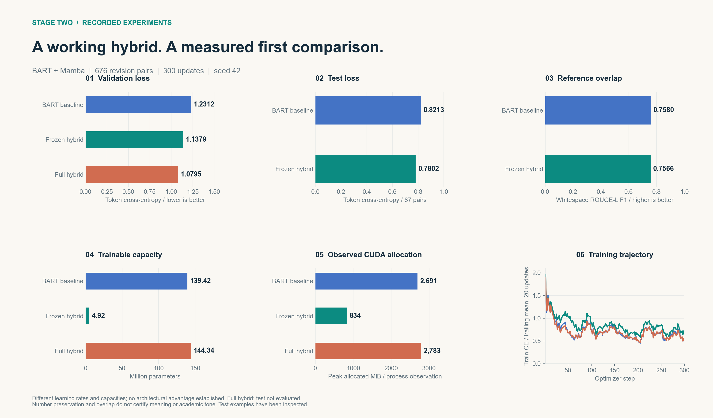

# Academic Text Style Enhancement

A BART + Mamba prototype for academic sentence revision. Current evidence includes real revision data, pretrained training, saved checkpoints and an inspected test comparison. It does not yet establish better academic tone or meaning preservation.

## Presentation and results

- **[Stage-two interactive visual report](output/stage-two/index.html)**: download and open locally; compare both models across all 87 test examples, search/filter cases and inspect token edits
- [Stage-two figure gallery and rebuild instructions](docs/Stage_Two_Visualization.md), with PNG/SVG exports and source fingerprints
- [Five-minute English presentation](output/presentation-5min-en/Academic_Text_Style_Enhancement_5min_EN.pptx)
- [Timed English speaker script](output/presentation-5min-en/English_Speaker_Script_5min.md), also embedded in the slide notes
- [Interactive test examples](output/visualizations/test-results.html): open locally in a browser, or download the repository first
- [One-page second-submission report](output/second-submission/Second_Submission_Report_EN.pdf) and [editable report text](docs/Milestone_Report.md)
- [Progress evidence](docs/Progress_Evidence.md)
- [Architecture and evaluation protocol](docs/Architecture_and_Protocol.md)
- [Dataset card](docs/Dataset_Card.md) and [learning-rate analysis](docs/Learning_Rate_Analysis.md)

## Current evidence

The pinned IteraTeR-HUMAN sentence release contains 4,018 records. Cleaning retains 676 arXiv pairs across 95 documents: 491 training, 98 validation and 87 test pairs. Recorded cross-split document and exact-text intersections are zero. Only 24 pairs carry a style label.

All three pretrained runs below use facebook/bart-base, 300 updates, batch size 2, seed 42 and a 128-token limit.

| Run | Backbone | Learning rate | Trainable parameters | Validation token CE |
| --- | --- | ---: | ---: | ---: |
| BART baseline | Trainable | 5e-5 | 139,420,416 | 1.2312 |
| Frozen hybrid | Frozen | 1e-4 | 4,915,968 | 1.1379 |
| Full hybrid | Trainable | 2e-5 | 144,336,384 | 1.0795 |

Learning rates and trainable parameter counts differ. These single-seed observations do not isolate an architectural advantage.

| Test metric, 87 pairs | BART baseline | Frozen hybrid |
| --- | ---: | ---: |
| Whitespace ROUGE-L F1 | 0.7580 | 0.7566 |
| Token cross-entropy | 0.8213 | 0.7802 |
| Detected number multisets preserved | 87/87 | 85/87 |
| Exact copies of source | 24/87 | 24/87 |

Generation is deterministic, with a 128-token input limit and at most 48 new tokens. ROUGE-L is a whitespace diagnostic. Number checks include examples without numbers and cannot certify meaning. The test set has been evaluated and inspected. Future confirmatory work needs fresh held-out examples or a revised protocol.

## Installation

Python 3.10+ is required. On a new computer:

~~~powershell
powershell -NoProfile -ExecutionPolicy Bypass -File scripts/setup.ps1
if ($LASTEXITCODE -ne 0) { throw 'Setup failed' }
.\.venv\Scripts\python.exe -m unittest discover -s tests -v
~~~

On Linux or macOS, create a virtual environment and run python -m pip install -e . with that environment's interpreter. The recorded GPU environment used Python 3.11, PyTorch 2.2.0+cu121, Transformers 4.44.2 and an RTX 4060 Laptop GPU. CPU execution is supported.

The existing environment on the original computer can be reused with scripts/setup.ps1 -Offline. It shares packages from D:\conda\envs\tee. Preserve that base environment and do not recreate .venv over it. See [environment setup](docs/Environment_Setup.md).

## Reproduction

Raw and processed data are included. To download the pinned release again and rebuild processed splits:

~~~powershell
.\.venv\Scripts\python.exe scripts/download_data.py
.\.venv\Scripts\python.exe -m academic_rewriter.prepare
~~~

Use new output directories to preserve the recorded experiments:

~~~powershell
.\.venv\Scripts\python.exe -m academic_rewriter.run --tiny --model hybrid --backend reference --fusion gated --output runs/new_smoke --steps 30
.\.venv\Scripts\python.exe -m academic_rewriter.run --model transformer --pretrained facebook/bart-base --output runs/new_baseline --steps 300 --train-limit 0 --val-limit 0 --batch-size 2 --lr 5e-5
.\.venv\Scripts\python.exe -m academic_rewriter.run --model hybrid --pretrained facebook/bart-base --backend reference --freeze-backbone --output runs/new_frozen_hybrid --steps 300 --train-limit 0 --val-limit 0 --batch-size 2 --lr 1e-4
.\.venv\Scripts\python.exe -m academic_rewriter.test --checkpoint runs/bart_adapter_visible --split validation --output runs/new_validation
.\.venv\Scripts\python.exe -m academic_rewriter.demo --checkpoint runs/bart_adapter_visible --text 'We looked at a lot of samples.' --force
~~~

Use --eval-every 50 for validation histories and --lr-scheduler plateau for optional validation-driven scheduling. The runner saves final-step weights, not a selected best checkpoint. --local-files-only requires the pretrained model in the local Hugging Face cache.

Learning-rate comparisons use scripts/tune_learning_rate.py. Regenerate their English report and figures with scripts/report_learning_rate.py. Install the optional plotting dependency with python -m pip install -e '.[analysis]' first.

## GitHub synchronization

After each completed change in this project, validate the affected outputs, update the integrity manifest, commit the relevant files and push the current branch to its configured GitHub upstream. This workflow is recorded in [AGENTS.md](AGENTS.md) for future coding sessions. If a push fails, keep the local commit and report that synchronization is pending.

## Included files and Git LFS

The repository includes source, tests, configs, setup and download scripts, original and processed data, completed experiment checkpoints with tokenizers/configs, logs, English documentation, the latest English presentation, analysis figures and original project references. See [the run inventory](runs/README.md).

Model weights use Git LFS. For a complete download:

~~~powershell
git lfs install
git clone https://github.com/Boruy/academic-hybrid-rewriter.git
cd academic-hybrid-rewriter
git lfs pull
git lfs fsck
powershell -NoProfile -ExecutionPolicy Bypass -File scripts/verify_integrity.ps1
~~~

Source ZIP downloads may contain LFS pointers instead of weights. SHA256SUMS.txt covers project files using the actual checkpoint bytes. .venv, cached pretrained dependencies, bytecode and temporary builds are local installation or generated files and are excluded.

## Limitations and provenance

The detector uses transparent heuristics. The current Mamba module uses a sequential PyTorch reference scan with unverified parity against official kernels. The hybrid retains Transformer attention. Optimized speedups, independent academic-tone ratings, human meaning checks, matched multi-seed comparisons and fusion ablations remain future work.

Data: [IteraTeR-HUMAN](https://huggingface.co/datasets/wanyu/IteraTeR_human_sent), revision e22e0371dac444239b944f9293f5b491d62b73f0. Preserve [third-party attribution](THIRD_PARTY_NOTICES.md) and data/IteraTeR_LICENSE.txt. Proposal.pdf and MLPre1.pptx are original project references. No new license is assigned here to the team's original code.
