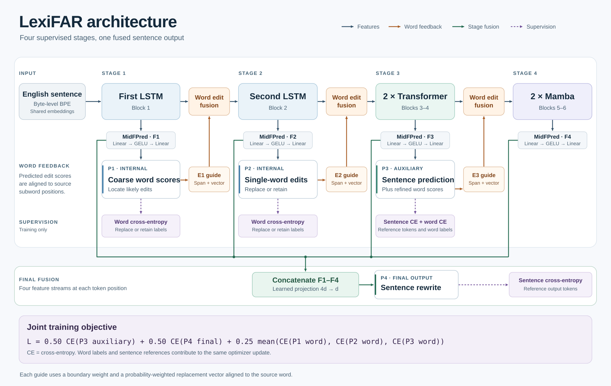

# LexiFAR architecture

LexiFAR trains all four stages jointly. The first three predictions provide word feedback and auxiliary supervision. The final prediction combines features from all four stages and returns one rewritten sentence.

| Prediction | Model | Role |
| --- | --- | --- |
| P1 | After the first LSTM | Locates words likely to need edits and creates guide E1. |
| P2 | After the second LSTM | Predicts a single-word replacement or retention and creates guide E2. |
| P3 | After the two Transformer blocks | Supervises an auxiliary sentence head and predicts refined word scores for guide E3. |
| P4 | After fusion of F1, F2, F3 and F4 | Generates the single final rewrite. F4 comes from the two Mamba blocks. |

## Architecture and loss



The purple paths carry F1–F4 into the final vocabulary head at P4. The right inset shows how each source word provides a location weight and a probability-weighted replacement vector for the next stage. Double-headed arrows mark cross-entropy (CE) supervision during joint training. [Open the editable English diagram](figures/LexiFAR_Architecture.svg).

Each stage has a `MidFPred` projection with two linear layers and GELU. The shared word edit module takes the place of CDEA. At P1, P2 and P3 it reads the final subword of the source span and the sentence-end representation. It predicts `KEEP` and the word's available replacements. With contextual edits enabled, it also predicts a generic `EDIT` class for aligned spans throughout the sentence, including words outside the replacement list. The guide to the next stage has two components.

- **Location.** Map `1 − P(KEEP)` to the source subwords and use one-dimensional dilation minus erosion to emphasize the local boundaries. The resulting weight scales a learned residual on the source features.
- **Replacement.** Multiply each allowed replacement's learned vector by its probability and sum the vectors. Add this residual at the source word's aligned subwords. The `KEEP` and generic `EDIT` classes contribute zero to this sum. The vectors start at zero and are learned in the joint run.

For example, an edit to `get access` can pass a vector weighted toward `gain`, while an edit to `get estimates` can pass a vector weighted toward `obtain`. Both components use the input sentence during training and cached decoding. The original source tokens remain in the prefix.

At every token position, the model concatenates the four projected features F1–F4. A learned `4d → d` projection produces the fused feature for the vocabulary head. The same fusion runs in the training forward pass and cached generation. P4 mixes vocabulary and source-copy probabilities. With contextual edits enabled, it subtracts the unexpanded E3 edit weight from the copy attention logit at each source position, favoring retention of positions with smaller edit weights. Boundary enhancement still supplies the residual guide between stages.

Each optimizer update uses a batch of [sentence pairs](../data/academic-pairs-v1/README.md) and a batch of [word pairs](../data/word-formality-v1/README.md). The default loss is `0.5 × CE(P3 sentence) + 0.5 × CE(P4 sentence) + 0.25 × word replacement CE + 0.25 × source-edit BCE`. Both word losses average P1, P2 and P3. Within the real training pairs, exact aligned source spans supply `KEEP` labels and replaced or deleted spans supply edit labels. Pure insertions receive sentence-level supervision. References supply these loss labels and E1–E3 are computed from the source. Checkpoint selection uses the fused final cross-entropy on the real validation split.

## Train once and generate the final rewrite

Run from the repository root in PowerShell. The default training config replaces the checkpoint and training logs in the selected output directory when rerun.

```powershell
$python = '.\.venv\Scripts\python.exe'
$checkpoint = 'runs/six_layer_joint_v6_edits'
$sentence = 'The proposed method gets better results than the baseline.'
& $python scripts/train_six_layer.py --output $checkpoint
& $python -m academic_rewriter.rewrite --checkpoint $checkpoint --text $sentence
```

Joint checkpoints record the stage layout, feature fusion, replacement vocabulary, candidate guidance, source copying and contextual edits in `six_layer_config.json`. Earlier checkpoints load their saved output and guidance settings. The single-sentence command returns the source if the rewrite is empty, lacks an end token or changes the numeric strings.

## Test the fused rewrite

```powershell
& $python -m academic_rewriter.test --checkpoint $checkpoint --split test --limit 0
& $python -m unittest discover -s tests -p test_joint_rewriter.py -v
```

The test command evaluates all 87 real test pairs by default. Use `--split validation` for the 98 validation pairs. The CSV and JSONL each contain one `prediction` per input, aligned with the source and human reference. JSONL also includes token and generation diagnostics. `metrics.json` reports final sentence metrics and a copy-input baseline. The batch test exports raw fused generations for diagnostics. The existing real splits have already been inspected and support exploratory comparison.

To audit internal word decisions, pass `--word-test .cache/reviewed_word_pairs.jsonl` with distinct, independently reviewed real cases. Each row needs `source` and `target`. For retain cases, include `focus` and, for repeated words, `focus_start`. The result provides aggregate focused replacement accuracy, unnecessary edit rate and exact sentence accuracy. The included word corpus is training only.

## Evaluation and loss informed by Doolittle

Diao et al. evaluate paragraph-level academic formalization with several measures. Apply the same dimensions to this project's sentence-level task and report them separately. Paragraph scores from the original benchmark are specific to its data and evaluation models. See [Doolittle, Sections 4.1 and 6.2](https://aclanthology.org/2023.emnlp-main.809.pdf).

| Dimension | Doolittle measure | Use for the final rewrite |
| --- | --- | --- |
| Academic formality and edits | CoLA and AESW RoBERTa acceptability classifiers (`ACC-cola`, `ACC-aesw`), plus SARI and GLEU | Prioritize change in formality from input to output. Use AESW as a scientific-writing proxy and CoLA as a grammatical acceptability check. SARI and GLEU complement review when human rewrites are available. |
| Fluency | Perplexity (`PPL`) under GPT-2 Large tuned on formal academic writing | Use the same external language model for source and output. Report lower PPL as better under that model. |
| Meaning preservation | Subword embedding similarity to input (`SIM-input`) and human rewrite (`SIM-gold`) | Report both. A copy can score highly against its input. Review numbers, units, negation, uncertainty and claims separately. |
| Conditional generation quality | BARTScore (`BARTS`) | Record the scoring direction and fixed scorer checkpoint. Treat the score as a supplementary diagnostic. |

The current evaluator provides ROUGE-L, optional BLEU, copy rate and number preservation as diagnostics. The external Doolittle measures above describe a proposed comparison. Pin scorer checkpoints, tokenization and score direction for any experiment using them. Report the original input as a copy baseline.

Use two independent reviewers with system names hidden to assess the final rewrite. Rate academic formality by precision and register, fluency by grammar and coherence, and meaning preservation by comparing output with input. Use a 1–5 scale for each dimension and log changed facts separately. Score input formality and fluency too, include already acceptable inputs, and tag expected edit scope before inspecting outputs. Doolittle used GPT-4 for separate 1–5 judgments on a test subset. Report any such scores separately from independent human judgments. See [Doolittle, Section 6.2 and Appendix E](https://aclanthology.org/2023.emnlp-main.809.pdf).

The joint supervised checkpoint is the baseline for this comparison. Validation cross-entropy measures prediction of reference tokens. External PPL and formality scores measure properties of the generated text.

Doolittle applies **metric-oriented reinforcement learning (MORL)** after preparing a rewriting policy. Its reward combines the AESW positive-class logit, output PPL, SIM-input and BARTScore. PPO updates the policy using this reward on generated rewrites and uses a KL penalty relative to the pre-RL policy. For example, with AESW as the classifier, the published Galactica notebook computes `0.01 * BARTScore(input, output) - PPL(output) / 200 + 0.01 * SIM(input, output) + 0.01 * AESW_logit(output)`. This formula describes the example implementation. See [Doolittle, Section 5 and Appendix B](https://aclanthology.org/2023.emnlp-main.809.pdf) and the [authors' Galactica notebook](https://github.com/shizhediao/Doolittle/blob/main/MORL-Galactica.ipynb).

Use the metrics first to compare the supervised checkpoints. A separate MORL experiment can start from the supervised fused checkpoint, compare against that starting checkpoint, and choose reward scales and checkpoints on validation data. Use the final test split after selection. Report each score and factual-error rate alongside the reward so a fluency or formality gain remains visible alongside any loss of meaning. A fresh confirmatory comparison requires separately versioned, independently reviewed data.
