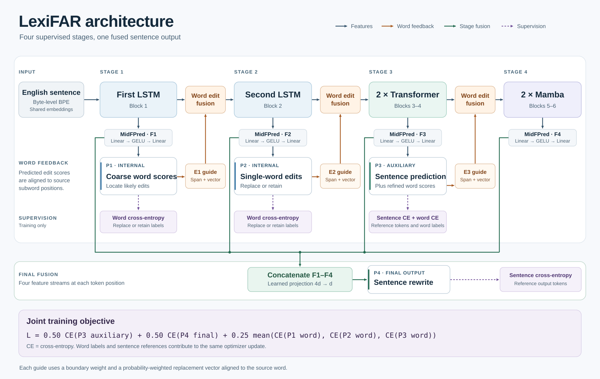

# LexiFAR 学术英语改写项目总览

**LexiFAR**（Lexically Guided Feature Fusion for Academic Rewriting）把不够正式的英文科研句子改成更准确、自然的学术表达，同时保留原文中的事实、数字、专业术语、否定和不确定性。模型在一次训练中学习四个阶段，把四级特征融合后生成一句改写。

早期实验比较过 BART 和 BART + Mamba。现在的训练主线是自建的六层因果模型，历史实验仍可在 Git 历史中查阅。比较结果时，需要区分模型、分词器、数据和解码设置。

## 模型怎么工作



紫色连线表示 F1–F4 在 P4 拼接并生成唯一的最终改写。右侧详图展示原词的位置权重和候选词向量如何传入下一阶段，双向箭头表示联合训练中的交叉熵监督。[打开可编辑的英文流程图](figures/LexiFAR_Architecture.svg)。

| 预测点 | 实现 | 作用 |
| --- | --- | --- |
| P1 | 第一层 LSTM | 定位可能需要修改的单词，生成词级引导 E1。 |
| P2 | 第二层 LSTM | 学习单词替换或保留，生成 E2。例如根据语境替换 `get access` 中的 `get`，保留 `get stuck` 中的 `get`。 |
| P3 | 两层 Transformer | 通过辅助句级预测学习重述，并细化词分数以生成 E3。 |
| P4 | 融合 F1、F2、F3 与两层 Mamba 后的 F4 | 解码为唯一的最终改写句子。 |

第 1、2、4、6 个序列块后各有一个 MidFPred 投影。替代 CDEA 的词级模块由 P1、P2、P3 共享。模块利用原词和整句语境预测 `KEEP` 与各候选词的概率。每次级间引导由两个部分组成。

- **位置**用 `1 − P(KEEP)` 定位可能需要修改的词，并用一维膨胀减腐蚀突出子词边界。
- **替换内容**按概率加权求和候选词向量，再作为残差加到原词的子词位置。`KEEP` 对候选向量的贡献为零。同一个 `get` 可按语境传递 `gain` 或 `obtain` 的信息。

每个 token 位置的 F1–F4 特征拼接后，用一层可学习的 `4d → d` 投影融合成 P4 的输入。训练和缓存解码都从原文计算词级引导，参考答案用于训练监督。详见[结构图与联合训练说明](LexiFAR_Architecture.md#architecture-and-loss)。

句级训练以原文作前缀，只对参考改写的 token 计算交叉熵。常规训练从随机权重开始，字节级 BPE 分词器只使用两个训练语料拟合。推理按顺序贪心生成。Mamba 使用 PyTorch 实现的参考递推。

单句改写命令发现最终候选为空、未正常结束或数字发生变化时，会返回原文并记录原因。单位、论断的强弱和逻辑关系仍需核对。详见[模型结构](LexiFAR_Architecture.md)和[训练文档](LexiFAR_Training.md)。

## 数据从哪里来

| 数据 | 规模 | 用途与状态 |
| --- | --- | --- |
| `academic-pairs-v1` 训练集 | 12,491 对，其中 491 对真实修订、12,000 对合成句对 | 训练 P3 辅助句级目标和 P4 最终句级目标。真实修订来自 IteraTeR，混有风格、清晰度和流畅度等修改。合成样本覆盖 48 种语义模板和 24 个技术领域。 |
| `academic-pairs-v1` 验证集和测试集 | 98 对真实验证样本、87 对真实测试样本 | 按文档组划分。该版本完整保留了已有验证集和测试集的字节内容。两套数据都已用于诊断。 |
| `word-formality-v1` | 76 条合成样本，其中 56 条换词、20 条保留原词，覆盖 12 种输入词形 | 在同一次训练中监督 P1、P2、P3 的词级预测。独立词级评估需要另行准备经过人工复核的样本。 |
| `data/curation/` | IteraTeR 的 100 条初步审核记录，以及 arXivEdits 的冻结分区和来源记录 | 用于追溯数据来源和筛选过程。arXivEdits 记录中独立人工确认的新样本数为 0。 |

合成数据只用于训练。当前句对数据及其生成器哈希已冻结。调整语料或划分时，应建立新版本。新增论文原文和私有盲审映射保存在本地忽略目录。详见[数据卡](Dataset_Card.md)、[句对语料](../data/academic-pairs-v1/README.md)和[词级语料](../data/word-formality-v1/README.md)。

## 怎么训练和评价

每一步取一批句对与一批词级样本，做一次参数更新。默认总损失为 `0.5 × P3 辅助句级 CE + 0.5 × P4 最终句级 CE + 0.25 × 词级 CE`，其中词级 CE 取 P1、P2、P3 三次词级预测的分类损失平均值。训练结束得到一个检查点，推理只生成 P4 的最终句子。

[默认实验配置](../configs/six_layer_experiment.json)的隐藏维度为 192、批量大小为 16、学习率为 `3e-4`，最多训练 2,000 步，每 250 步验证一次，按 P4 的验证交叉熵选择检查点。测试评价最终句子与复制原文的基线，报告 ROUGE-L、可选的 SacreBLEU、复制率、数字保留率与截断诊断。提供独立词级评估样本时，还能单独核对词模块的准确率和误改率。

参照 **Doolittle（EMNLP 2023）** 的思路，计划分别评估最终改写的学术正式度、流畅度与语义保留，并把原样返回作为基线。建议采用两个独立评审者的盲评，同时检查数值、单位、否定、限定条件和结论是否改变。AESW、外部语言模型困惑度、`SIM-input` 和 `SIM-gold` 等指标已写入方案，尚待接入。论文的 MORL 用生成结果的多个指标计算奖励，再使用 PPO 更新模型。它可以作为融合模型的后续对照实验。详见[评价与 Loss 方案](LexiFAR_Architecture.md#evaluation-and-loss-informed-by-doolittle)。

## 在 PowerShell 中运行

从仓库根目录操作，需要 Python 3.10 或以上。首次安装运行下面的命令。已有可用的离线环境可以加上 `-Offline`。详见[环境配置](Environment_Setup.md)。

```powershell
powershell -NoProfile -ExecutionPolicy Bypass -File scripts/setup.ps1
```

下面先联合训练一次，再用同一个检查点试用与测试。默认配置会在指定目录重新训练并覆盖权重和训练日志。训练完整结束后写入 `result.json`，表示检查点可用于测试。

```powershell
$python = '.\.venv\Scripts\python.exe'
$runDir = 'runs/six_layer_joint_v4'
$sentence = 'The proposed method gets better results than the baseline.'

# 联合训练一个检查点
& $python scripts/train_six_layer.py --output $runDir

# 生成并测试融合后的最终句子
& $python -m academic_rewriter.rewrite --checkpoint $runDir --text $sentence
& $python -m academic_rewriter.test --checkpoint $runDir --split test --limit 0
```

训练终端默认每步打印总损失、近 20 步平均损失、P3 和 P4 的句级交叉熵、词级交叉熵、学习率和耗时，并显示验证的开始与结果。加 `--log-every 10` 可改为每 10 步打印一次。`training_progress.jsonl` 保存逐步记录。

`--limit 0` 测试全部 87 条真实测试样本。`evaluation/test-192/` 中的 `predictions.csv` 和 `predictions.jsonl` 按行对齐原文、人工参考和最终改写。`metrics.json` 记录最终指标、复制基线、是否启用候选词引导和内部预测点 `[1, 2, 4, 6]`。改成 `--split validation` 可诊断全部 98 条验证样本。准备好独立人工复核的词级样本后可加 `--word-test .cache/reviewed_word_pairs.jsonl`。训练权重和预测保存在本地忽略目录。

要比较候选词向量的贡献，可在同样的设置下加 `--word-guidance position --output runs/six_layer_joint_v4_position` 训练位置引导的对照检查点，并用同一测试命令评估。详见[训练和测试命令](LexiFAR_Training.md#evaluate-the-entire-split)。

## 本次运行的逐条结果

2026-11-21 保存的 `six_layer_joint_v4` 和 2026-11-22 保存的 `six_layer_joint_v4_embscale` 使用相同的训练数据、分词器、随机种子和训练参数。后一次训练将三张输入嵌入表的初始标准差统一为 0.02。两次均选择了第 2,000 步的检查点，以 192 个新 token 为上限进行贪心解码。下表按同一组样本 ID 对齐。复制基线直接用原句对照人工参考。

| 分组 | 原始 ROUGE-L | 统一尺度后 ROUGE-L | 复制原句 ROUGE-L | 新模型低于基线 | 新模型完整保留数字 / 含数字原句 |
| --- | ---: | ---: | ---: | ---: | ---: |
| 测试集 | 0.0685 | 0.1602 | 0.8503 | 86 / 87 | 1 / 7 |
| 验证集 | 0.0891 | 0.1873 | 0.8230 | 98 / 98 | 0 / 4 |

### 11 月 22 日的生成质量

新模型的 P4 验证交叉熵从旧模型的 6.9920 改善至 5.3626，四个以上连续逗号、句点或连字符的预测由 128 条降至零。它也能利用部分原句信息。在测试集中，将相同原句去重后，有 39 个原句能找到 token 数相同的其他原句。其中 38 个的预测与本句的 ROUGE-L 高于该预测与这些其他原句的平均分。旧模型为 16/39。

主要缺陷是保留事实。按测试集全部 5,207 个原句子词计，用同一分词器去掉特殊标记，逐句取最长公共子序列再求和，人工参考按原顺序保留了 4,255 个（81.7%），新预测只保留了 670 个（12.9%）。验证样本 033 的原句和人工参考都有 `7,000`，新预测却出现 `581` 和 `7`。两个分组中另外有 33 条原句按项目规则没有数字，新预测引入了数字。模型有 8 条验证预测和 6 条测试预测触及生成上限，输入和参考的截断数均为零。

训练句对中有 12,000 条来自 48 种合成模板，真实修订只有 491 条。按冻结分词器计，测试参考共 4,776 个子词位置，其中 3,445 个对应的子词在全部合成目标句中一次也没出现。新模型最后 100 个训练批次的 P4 交叉熵均值为 0.298，整组真实验证句为 5.363。模型对训练分布的拟合远好于对真实句子的预测。

词级模块的 12 个触发词在这 185 条原句中均未命中。P4 融合特征后从整个词表生成，保留原词、数字和术语也需要模型在训练中学会。现有对照支持改善输入尺度，尚不足以判定哪一类序列块造成了剩余误差。

查看最新逐句结果时，打开[本地结果查看器](results/index.html)，点“载入训练目录”并选择 `runs/six_layer_joint_v4_embscale`。本机 `output/lexifar-results/index.html` 内嵌的是 11 月 21 日的旧快照。两个入口都可以载入新目录、搜索样本并切换差异高亮。

### 原始预测为什么需要重查

11 月 21 日的原始检查点在全部 185 条上低于复制基线。验证集中一条 LayoutLM 样本的人工修改只把 `in` 换成 `into`，模型却生成了有关训练终止和分类器的句子。测试集有 17 条生成结果与参考的 ROUGE-L 为零，验证集有 16 条。两组的输入截断、参考截断和触及生成上限的记录均为零。

测试样本 024 讨论代码公开，029 讨论位置嵌入。两条原句各有 21 个 token，模型逐字生成了同一句关于实体识别耗时的文本。测试集还有 63/87 条、验证集有 65/98 条预测出现至少四个连续的逗号、句点或连字符，两组原句中均为零。185 条预测全部没有输出数字字符。项目数字规则检出的 11 条含数字原句中，人工参考全部保留了原数字。

从 11 月 21 日的 `weights.pt` 读取参数，普通词元（排除四个特殊 token）的嵌入均方根为 0.0507，前 192 个位置为 0.9880，原文段向量为 0.9730。输入层直接把这三个向量相加。旧实现只把词元的初始化标准差设为 0.02，另外两张表使用标准差 1。这个差异会减小词元身份在输入和中的相对幅度，是需要做对照的一个原因。新模型将三者初始化标准差统一为 0.02。

按训练代码的候选词匹配规则核对，12 个触发词在验证集命中 0/98，在测试集命中 0/87，真实训练句中也只命中 6/491。因此本次逐句评估中的 P4 生成全部缺少直接的词级引导。句级训练集另有 12,000 条合成样本，占 96.1%。验证样本 001 无端生成的短语 `was terminated after` 出现在 385 条合成目标句中，真实训练目标句中出现 0 次。模板偏向对生成失败的贡献仍需单独验证。

需要核验项目时，可在根目录手动执行以下命令。训练、推理、测试和其他项目脚本由用户执行，除非用户明确授权代跑。

```powershell
.\.venv\Scripts\python.exe -m unittest discover -s tests -v
powershell -NoProfile -ExecutionPolicy Bypass -File scripts/verify_integrity.ps1
```

## 当前进度与维护

两次完整联合训练的逐条验证和测试预测均已导出。初始化对照已完成，真实句子的内容保留仍不达标。训练语料配比、位置引导对照、独立词级评估、人工盲评与 MORL 对照仍待实测。

以后每次完成一项项目修改，都要在同一提交里同步这份总览。更新受影响的章节，并在下面记录改动和实际验证情况。规则见[仓库维护说明](../AGENTS.md)。

| 日期 | 改动 | 验证与状态 |
| --- | --- | --- |
| 2026-11-22 | 补录统一输入尺度后的复测，对照两次运行的生成质量、原文保留和数字错误。 | 已核对分词器、日志、保存权重和两组全量预测，逐条与冻结分组按 ID 对齐。 |
| 2026-11-22 | 核查重复标点、跨原句相同预测、数字丢失和词级覆盖，修正新模型三张输入嵌入表的初始化尺度。 | 已复核保存的预测、词表、数据和权重，静态检查训练与加载路径。初始化回归和新模型生成质量待手动验证。 |
| 2026-11-21 | 增加中文离线结果网页，支持逐条三列对照、差异高亮、基线和数字筛选，以及训练曲线。 | 已对齐 185 条原始预测及冻结分组，复核网页汇总与评估文件，检查了离线打开、目录导入、样本筛选和曲线。 |
| 2026-11-21 | 按参考图的横向排版重绘英文架构图，展开单词修改模块，标明 P3 的辅助句级监督和四路特征汇入 P4 的路径。 | 已对照模型实现与默认损失权重核对，逐区检查了高清渲染图的英文标注和连线。 |
| 2026-11-21 | 默认训练命令覆盖目标目录的训练产物，权重和日志写完后再发布完成记录。 | 已静态核对配置和训练入口。覆盖重训及中断回归待手动运行。 |
| 2026-11-21 | 训练终端默认逐步打印联合损失的各分项和进度，验证开始时提示，并支持 `--log-every` 调整频率。 | 已静态核对训练入口和配置。终端输出回归待手动运行。 |
| 2026-11-20 | 在 P1–P3 的词级引导中加入概率加权的候选词向量，提供位置引导对照选项。 | 已静态核对代码、配置和文档。候选词对齐、梯度、缓存解码、检查点加载和端到端回归待手动验证。 |
| 2026-11-19 | 将模型命名为 LexiFAR，重命名架构文档、训练文档和模型图，同步 README 和中文总览。 | 已核对文档链接、章节锚点和图中标题。 |
| 2026-11-19 | 把 F1–F4 拼接后融合，推理和测试只返回 P4。模型图同步标出四条特征路径和唯一的最终输出。 | 静态核对代码和图。融合梯度、缓存解码和单一输出的回归检查待手动运行。 |
| 2026-11-19 | 绘制四阶段模型矢量图，标出 P1 至 P4、E1 至 E3、词级融合和联合训练损失。 | 图中的预测点、连接和损失已与当前实现核对。 |
| 2026-11-19 | 按参考图补齐 P1 至 P4、四个中间投影和三次词级反馈，保留浅、中、深三个对外输出。 | 静态核对模型路径与数据。新增级间梯度、缓存解码、旧版兼容和统一测试检查，待手动运行。 |
| 2026-11-19 | 参考多阶段分割图，加入两次词级引导。三种输出联合训练成一个检查点，并在同一测试集并排比较。 | 静态核对训练入口、数据清单和输出。新增梯度、缓存解码和联合测试用例，待手动运行。 |
| 2026-11-19 | 建立中文项目总览，增加 README 入口和每次修改同步更新的仓库规则。 | 核对现有代码、数据清单、操作命令和链接。 |
| 2026-11-19 | 增加浅、中、深三种模式和独立词级模块，记录 Doolittle 评价与 Loss 方案。 | 实现已静态检查。训练、推理及外部指标的实测待完成。 |
| 2026-11-17 | 加入六层模型与 `academic-pairs-v1` 训练语料。 | 数据版本、分割与生成器指纹记录在语料清单中。 |
