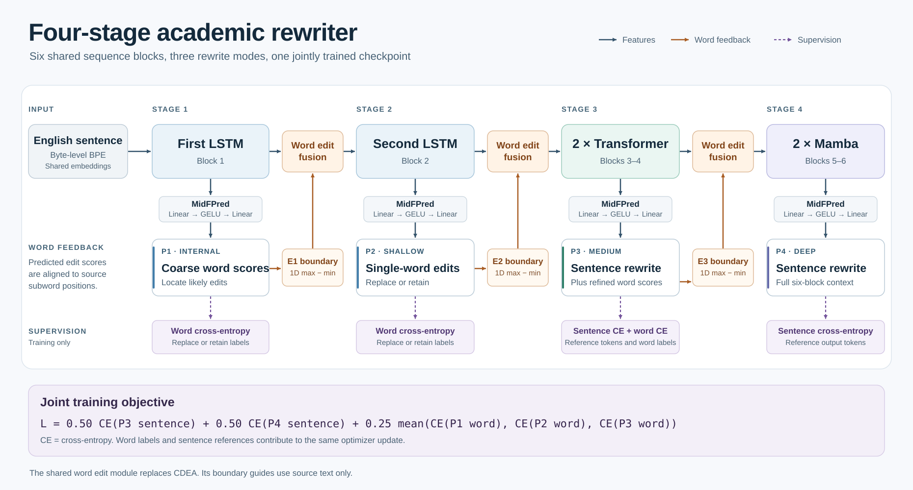

# 学术英语改写项目总览

本项目把不够正式的英文科研句子改成更准确、自然的学术表达，同时保留原文中的事实、数字、专业术语、否定和不确定性。当前以单句为单位，用一个模型联合训练浅层、中层和深层三个输出。

早期实验比较过 BART 和 BART + Mamba。现在的训练主线是自建的六层因果模型，历史实验仍可在 Git 历史中查阅。比较结果时，需要区分模型、分词器、数据和解码设置。

## 模型怎么工作



[查看四阶段模型矢量图](figures/four_stage_rewriter.svg)。

| 层级 | 实现 | 适用场景 |
| --- | --- | --- |
| 浅层 `shallow` | 第一层 LSTM 的 P1 预测哪些词可能需要修改，第二层 LSTM 的 P2 决定换词或保留。每处修改只替换一个词，其余文字、空格和标点保持原样。 | 个别词不够正式，句式本身合适。例如把 `get access` 改成 `gain access`，在 `get stuck` 中保留 `get`。 |
| 中层 `medium` | 两层 Transformer 后的 P3 生成句子，同时细化原文中各候选词的修改概率。 | 以局部重述为目标，例如调整短语和句内表达。实际修改幅度需要评估。 |
| 深层 `deep` | 使用 P3 产生的词级引导，再经两层 Mamba 得到 P4。六个序列块均参与。 | 以更大范围的句式调整为目标。当前以单句改写为主。 |

结构按参考图保留四个内部预测点 P1、P2、P3、P4，分别位于第 1、2、4、6 个序列块之后。每个预测点都有两层线性变换和 GELU，对应图里的 MidFPred。前三级都从当前阶段的原文特征预测该换还是该保留，把概率投到对应子词位置，再用一维膨胀减腐蚀突出词边界，形成 E1、E2、E3。取代 CDEA 的词级模块用这些引导图调整下一级的原文特征。参考答案只用于训练监督。详见[结构图与联合训练说明](Three_Level_Model.md#architecture-and-loss)。

句级训练以原文作前缀，只对参考改写的 token 计算交叉熵。常规训练从随机权重开始，字节级 BPE 分词器只使用两个训练语料拟合。推理按顺序贪心生成。Mamba 使用 PyTorch 实现的参考递推。

中层和深层的单句改写命令发现候选为空、未正常结束或数字发生变化时，会返回原文并记录原因。单位、论断的强弱和逻辑关系仍需核对。详见[三级使用说明](Three_Level_Model.md)和[六层架构](Six_Layer_Model.md)。

## 数据从哪里来

| 数据 | 规模 | 用途与状态 |
| --- | --- | --- |
| `academic-pairs-v1` 训练集 | 12,491 对，其中 491 对真实修订、12,000 对合成句对 | 训练中层和深层。真实修订来自 IteraTeR，混有风格、清晰度和流畅度等修改。合成样本覆盖 48 种语义模板和 24 个技术领域。 |
| `academic-pairs-v1` 验证集和测试集 | 98 对真实验证样本、87 对真实测试样本 | 按文档组划分。该版本完整保留了已有验证集和测试集的字节内容。两套数据都已用于诊断。 |
| `word-formality-v1` | 76 条合成样本，其中 56 条换词、20 条保留原词，覆盖 12 种输入词形 | 在同一次训练中监督 P1、P2、P3 的词级预测。独立词级评估需要另行准备经过人工复核的样本。 |
| `data/curation/` | IteraTeR 的 100 条初步审核记录，以及 arXivEdits 的冻结分区和来源记录 | 用于追溯数据来源和筛选过程。arXivEdits 记录中独立人工确认的新样本数为 0。 |

合成数据只用于训练。当前句对数据及其生成器哈希已冻结。调整语料或划分时，应建立新版本。新增论文原文和私有盲审映射保存在本地忽略目录。详见[数据卡](Dataset_Card.md)、[句对语料](../data/academic-pairs-v1/README.md)和[词级语料](../data/word-formality-v1/README.md)。

## 怎么训练和评价

每一步取一批句对与一批词级样本，做一次参数更新。默认总损失为 `0.5 × 中层句级 CE + 0.5 × 深层句级 CE + 0.25 × 词级 CE`，其中词级 CE 取 P1、P2、P3 三次词级预测的分类损失平均值。训练结束得到一个检查点，推理时选择输出层级。

[默认实验配置](../configs/six_layer_experiment.json)的隐藏维度为 192、批量大小为 16、学习率为 `3e-4`，最多训练 2,000 步，每 250 步验证一次，按中层与深层在验证集上的平均交叉熵选择检查点。统一测试在相同输入上输出三种预测和复制原文的对照，报告 ROUGE-L、可选的 SacreBLEU、复制率、数字保留率与截断诊断。提供独立词级评估样本时，还能报告目标词替换准确率、无需改动时的误改率和整句完全匹配率。

参照 **Doolittle（EMNLP 2023）** 的思路，中层和深层计划在同一批输入上比较学术正式度、流畅度与语义保留，并把原样返回作为基线。建议采用两个独立评审者的盲评，同时检查数值、单位、否定、限定条件和结论是否改变。AESW、外部语言模型困惑度、`SIM-input` 和 `SIM-gold` 等指标已写入方案，尚待接入。论文的 MORL 用生成结果的多个指标计算奖励，再使用 PPO 更新模型。本项目将它作为深层的后续对照实验。详见[评价与 Loss 方案](Three_Level_Model.md#evaluation-and-loss-informed-by-doolittle)。

## 在 PowerShell 中运行

从仓库根目录操作，需要 Python 3.10 或以上。首次安装运行下面的命令。已有可用的离线环境可以加上 `-Offline`。详见[环境配置](Environment_Setup.md)。

```powershell
powershell -NoProfile -ExecutionPolicy Bypass -File scripts/setup.ps1
```

下面先联合训练一次，再用同一个检查点试用与测试。再次训练时请改用新的输出目录。

```powershell
$python = '.\.venv\Scripts\python.exe'
$runDir = 'runs/six_layer_joint_v2'
$sentence = 'The proposed method gets better results than the baseline.'

# 联合训练一个检查点
& $python scripts/train_six_layer.py --output $runDir

# 指定模式试用，随后一次测试三种输出
& $python -m academic_rewriter.rewrite --depth shallow --checkpoint $runDir --text $sentence
& $python -m academic_rewriter.test --checkpoint $runDir --split test --limit 0
```

`--limit 0` 测试全部 87 条真实测试样本。`evaluation/test-192/` 中的 `predictions.csv` 和 `predictions.jsonl` 按行对齐原文、人工参考和三种改写。`metrics.json` 记录各模式、复制基线和内部预测点 `[1, 2, 4, 6]`。改成 `--split validation` 可诊断全部 98 条验证样本。准备好独立人工复核的词级样本后可加 `--word-test .cache/reviewed_word_pairs.jsonl`。训练权重和预测保存在本地忽略目录。

需要核验项目时，可在根目录手动执行以下命令。训练、推理、测试和其他项目脚本由用户执行，除非用户明确授权代跑。

```powershell
.\.venv\Scripts\python.exe -m unittest discover -s tests -v
powershell -NoProfile -ExecutionPolicy Bypass -File scripts/verify_integrity.ps1
```

## 当前进度与维护

四个内部预测点、三次词级引导和统一测试均已写入代码。新训练默认使用四阶段。旧检查点继续使用原来的布局。现有真实分割可用于诊断不同模式的问题。联合模型的训练、测试、独立人工盲评与 MORL 对照仍待实测。

以后每次完成一项项目修改，都要在同一提交里同步这份总览。更新受影响的章节，并在下面记录改动和实际验证情况。规则见[仓库维护说明](../AGENTS.md)。

| 日期 | 改动 | 验证与状态 |
| --- | --- | --- |
| 2026-11-19 | 绘制四阶段模型矢量图，标出 P1 至 P4、E1 至 E3、词级融合和联合训练损失。 | 图中的预测点、连接和损失已与当前实现核对。 |
| 2026-11-19 | 按参考图补齐 P1 至 P4、四个中间投影和三次词级反馈，保留浅、中、深三个对外输出。 | 静态核对模型路径与数据。新增级间梯度、缓存解码、旧版兼容和统一测试检查，待手动运行。 |
| 2026-11-19 | 参考多阶段分割图，加入两次词级引导。三种输出联合训练成一个检查点，并在同一测试集并排比较。 | 静态核对训练入口、数据清单和输出。新增梯度、缓存解码和联合测试用例，待手动运行。 |
| 2026-11-19 | 建立中文项目总览，增加 README 入口和每次修改同步更新的仓库规则。 | 核对现有代码、数据清单、操作命令和链接。 |
| 2026-11-19 | 增加浅、中、深三种模式和独立词级模块，记录 Doolittle 评价与 Loss 方案。 | 实现已静态检查。训练、推理及外部指标的实测待完成。 |
| 2026-11-17 | 加入六层模型与 `academic-pairs-v1` 训练语料。 | 数据版本、分割与生成器指纹记录在语料清单中。 |
