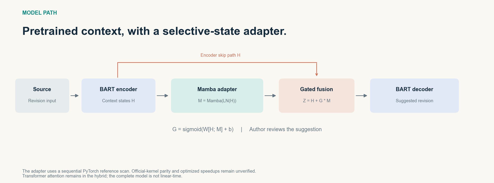
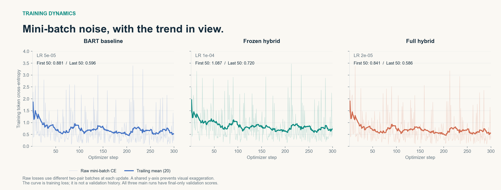
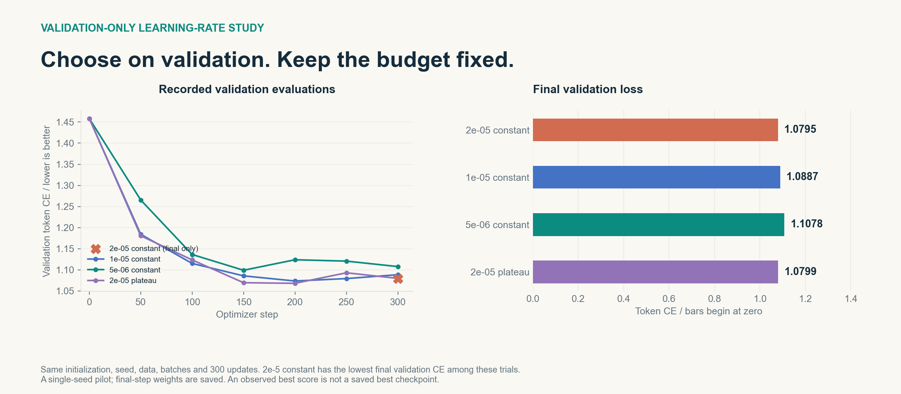
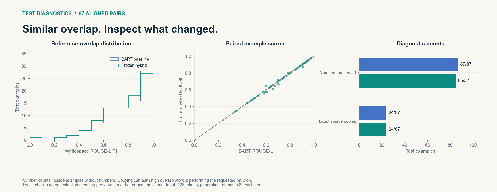

# Stage-two visual results

[Open the offline interactive report](../output/stage-two/index.html). Download the repository and open that file in a browser: GitHub displays HTML source rather than running the report. All charts and test cases are embedded in the HTML, so browsing the report itself needs no server or external libraries. Linked exports, numerical JSON and other documents are included alongside it in the repository.

The report follows the existing English second-submission materials. It reads saved experiment records and does not run new training or inference.

## Figure gallery

Each figure is provided as a high-resolution PNG and an editable vector SVG in output/stage-two.

### Recorded results

Three models share 300 updates, seed 42, batch size 2 and a 128-token input limit. Learning rates and trainable capacities differ. Full hybrid has no test evaluation. Horizontal comparison bars begin at zero. Training time and peak allocated CUDA memory are process observations, not controlled efficiency benchmarks.

### Architecture

The decoder cross-attends to gated encoder/adapter states. The adapter uses the sequential PyTorch reference scan. Official-kernel parity and optimized speedups remain unverified. Transformer attention remains in the hybrid.

### Training dynamics

Raw mini-batch loss and a trailing 20-update mean share a common y-axis across models. The initial mean uses all available preceding updates. These are training losses; the three main runs have final-only validation scores.

### Validation-only learning-rate comparison

Constant-rate full-hybrid trials share initialization, seed, data, batches and update budget. The additional plateau trial is labeled separately. Missing validation history is represented by a final-only point. The lowest final validation CE among these trials is at 2e-5 constant; test scores are not used for that choice. Saved weights are from the final step.

### Test diagnostics

The report compares all 87 aligned source/reference pairs and both model predictions. Its explorer supports text/ID search, number-mismatch and copy filters, higher-overlap subsets, score sorting, previous/next navigation and optional token edit markup. No examples are removed from the default view.

ROUGE-L uses lowercased whitespace tokens, matching academic_rewriter.evaluate. Numeric diagnostics use academic_rewriter.prepare.numbers; copies use stripped exact text. Markup uses case-sensitive whitespace tokens and highlights differences from the source, including deleted tokens that are absent from the output. Turn markup off to read the original output verbatim. These diagnostics do not establish academic-tone improvement or meaning preservation. Number preservation includes inputs without numbers. The test set has been inspected; confirmatory work needs fresh held-out examples or a revised protocol.

## Rebuild

With the project environment and optional analysis dependencies installed:

~~~powershell
.\.venv\Scripts\python.exe scripts/report_stage_two.py
~~~

The generator reads data/processed/stats.json, three main run result/training files, both test metric/prediction files and the saved validation-only learning-rate study. It checks prediction alignment, recorded test metrics, split totals and complete training steps before rendering. The JSON export includes all curves and cases plus SHA-256 fingerprints for 18 input files. The HTML embeds the same numerical data and all five SVG figures.

To change layout, edit scripts/templates/stage_two.html; to change the scientific figures, edit scripts/report_stage_two.py, then rebuild. Use a different --output path only if you also adjust relative links when moving the report to a different folder depth.

## Synchronization

README.md embeds the overview so GitHub readers see the figures directly. After completed changes, follow [AGENTS.md](../AGENTS.md): validate outputs, refresh the integrity manifest, commit the relevant files and push to the configured upstream.
